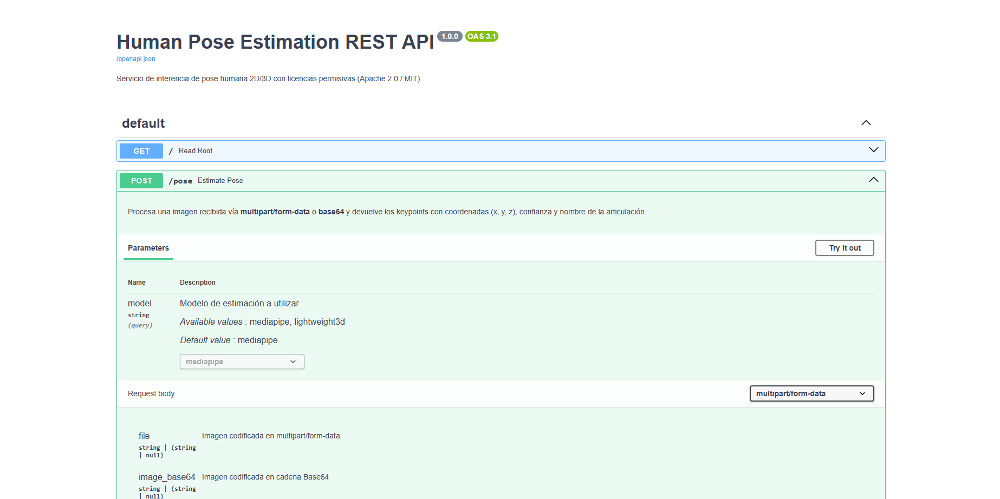
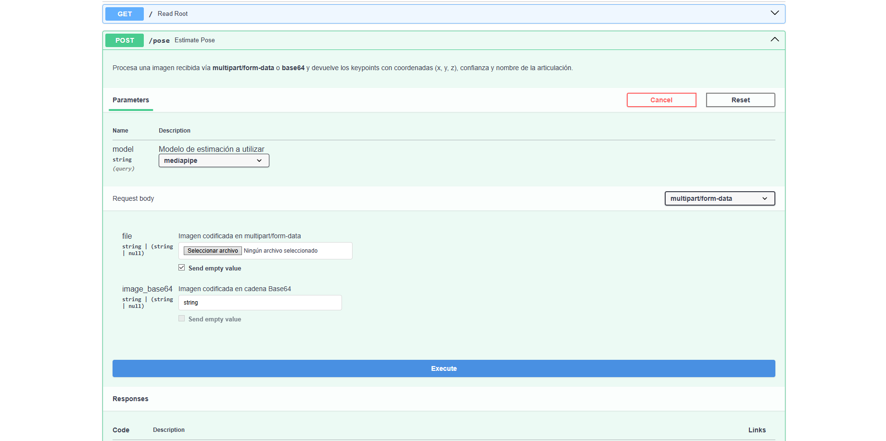

# Configuración

### Crear un env
```
python -m venv env
```

#
### Activar el env

#### Windows
```
env\Scripts\activate
```

#### Linux / Mac
```
source env/bin/activate
```

###
### Construir la imagen de docker
```
docker build -t pose-api .
```

### Ejecutar el contenedor
```
docker run -d -p 8000:8000 --name pose-api-service pose-api
```

# Uso del endpoint

## Desde [http://localhost:8000/docs](http://localhost:8000/docs)


Pinchar en try out


### Elegir modelo
Se pueden usar Mediapipe y Lightweight 3D

###
### Elegir imagen
Se pueden usar dos formatos:

Una imagen en webp, png, etc, o codificada en base64.
Si se proporcionan ambas, se prioriza la imagen en formato estandar.

###
### Enviar petición
Después de elegir imagen, pinchar en Execute

## Desde la terminal

#### Windows
```
curl.exe -s -X POST "http://localhost:8000/pose" -F "file=@/ruta_a_la_imagen/imagen.png" | python -m json.tool | tee resultado_formateado.json
```

#### Linux / Mac
```
curl -s -X POST "http://localhost:8000/pose" -F "file=@/ruta_a_la_imagen/imagen.png" | python -m json.tool | tee resultado_formateado.json
```


# Tests

### Ejecución de tests
```
docker run --rm pose-api pytest
```