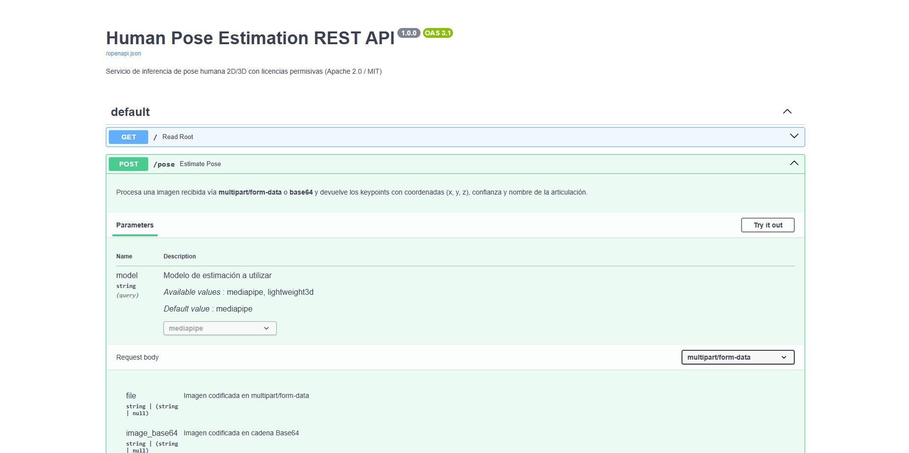
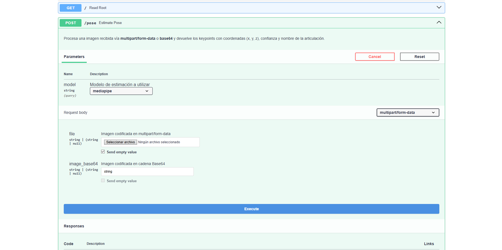

# Documentation: POST /pose API

Servicio de estimación de pose humana multi-persona (2D/3D) a partir de una imagen monocular, construido con **FastAPI**, **MediaPipe Tasks**, **PyTorch** y **Docker**.

Modelos disponibles:

* **`mediapipe`**: MediaPipe Pose Landmarker con estrategia **top-down** (ObjectDetector de personas + PoseLandmarker por recorte). Devuelve **33 keypoints** por persona.
* **`lightweight3d`**: Lightweight 3D Human Pose Estimation (Intel/OpenCV Community, Apache 2.0). Modelo **multi-persona** real basado en PAFs. Devuelve **19 keypoints** por persona.

---

## Endpoint Overview

* **URL:** `/pose`
* **Método HTTP:** `POST`
* **Content-Type:** `multipart/form-data`
* **Autenticación:** Ninguna (Pública)

---

## Petición (Request)

### Parámetros del Formulario (Form Data)

| Campo | Tipo | Requerido | Descripción |
| :--- | :--- | :---: | :--- |
| `file` | `binary` (file) | **No\*** | Archivo de imagen (`.jpg`, `.jpeg`, `.png`, `.webp`). |
| `image_base64` | `string` | **No\*** | Imagen codificada en Base64. |

\* Se debe proporcionar `file` o `image_base64`. Si se envían ambos, se prioriza `file`.

### Query parameters

| Parámetro | Tipo | Requerido | Descripción |
| :--- | :--- | :---: | :--- |
| `model` | `string` | No | `mediapipe` (por defecto) o `lightweight3d`. |

---

## Respuesta (Response)

### Estado HTTP: `200 OK`

Ambos modelos devuelven el mismo contrato **`PoseResponse`**, con una lista de personas detectadas (`poses`). Cada persona incluye su `person_id` y una lista de `keypoints`.

| Campo | Tipo | Descripción |
| :--- | :--- | :--- |
| `model_used` | `string` | Modelo utilizado para la inferencia. |
| `persons_detected` | `int` | Número de personas detectadas. |
| `poses` | `array` | Lista de poses, una por persona. |
| `poses[].person_id` | `int` | Identificador ordinal de la persona en la imagen. |
| `poses[].keypoints` | `array` | Keypoints de la persona. |

#### Estructura de cada Keypoint

| Campo | Tipo | Descripción |
| :--- | :--- | :--- |
| `name` | `string` | Nombre de la articulación (ej. `nose`, `left_shoulder`, `Neck`, `L_Wrist`). |
| `x` | `float` | Coordenada $X$ 2D normalizada en la imagen `[0.0, 1.0]`. |
| `y` | `float` | Coordenada $Y$ 2D normalizada en la imagen `[0.0, 1.0]`. |
| `z` | `float` | Profundidad estimada en metros. |
| `confidence` | `float` | Confianza/visibilidad del keypoint `[0.0, 1.0]`. `0.0` si no se detectó. |
| `coordinates_3d_meters` | `object \| null` | Coordenadas 3D (x, y, z) en metros en el espacio del mundo/cámara. |

> Nota: MediaPipe devuelve 33 keypoints por persona; Lightweight 3D devuelve 19 keypoints en orden panoptic (`Nose`, `Neck`, `Body_Center`, `L_Shoulder`, ...). Los keypoints no detectados por Lightweight 3D se incluyen con `confidence = 0.0`.

---

### Ejemplo de Respuesta JSON

```json
{
  "model_used": "MediaPipe Pose Landmarker (top-down)",
  "persons_detected": 2,
  "poses": [
    {
      "person_id": 1,
      "keypoints": [
        {
          "name": "nose",
          "x": 0.4312,
          "y": 0.1834,
          "z": -0.3898,
          "confidence": 0.9998,
          "coordinates_3d_meters": {
            "x": 0.0756,
            "y": -0.4955,
            "z": -0.3898
          }
        }
      ]
    },
    {
      "person_id": 2,
      "keypoints": [
        {
          "name": "nose",
          "x": 0.7121,
          "y": 0.2011,
          "z": -0.4012,
          "confidence": 0.9987,
          "coordinates_3d_meters": {
            "x": -0.0821,
            "y": -0.4712,
            "z": -0.4012
          }
        }
      ]
    }
  ]
}
```

### Estado HTTP: `400 Bad request`

El archivo enviado no es una imagen válida o está dañado.

```json
{
  "detail": "No se pudo decodificar la imagen."
}
```

### Estado HTTP: `503 Service Unavailable`

Falta el fichero de pesos/modelo necesario para el modelo solicitado o no está instalado PyTorch (solo `lightweight3d`).

```json
{
  "detail": "Modelo no disponible: No se encontró el modelo en: human-pose-estimation-3d.pth"
}
```

### Estado HTTP: `500 Internal Server Error`

Error interno procesando el modelo o falta de recursos.

```json
{
  "detail": "Error al procesar la imagen: err"
}
```

---

## Modelos necesarios

La API necesita estos ficheros en el directorio de trabajo (o descargarlos con el script):

| Fichero | Uso |
| :--- | :--- |
| `pose_landmarker_full.task` | MediaPipe Pose Landmarker. |
| `efficientdet_lite0.tflite` | MediaPipe ObjectDetector (detección de personas para el modo multi-persona). |
| `human-pose-estimation-3d.pth` | Pesos de Lightweight 3D. |

### Descarga local

```bash
python scripts/download_models.py
```

El script descarga los modelos de MediaPipe desde Google Storage y los pesos de Lightweight 3D desde Google Drive usando `gdown`.

---

## Configuración

### Crear un env
```
python -m venv env
```

### Activar el env

#### Windows
```
env\Scripts\activate
```

#### Linux / Mac
```
source env/bin/activate
```

### Instalar dependencias
```
pip install -r requirements.txt
```

---

## Docker

### Construir la imagen
```
docker build -t pose-api .
```

> La imagen instala `torch==2.6.0+cpu` usando el índice de PyTorch como principal y PyPI como `--extra-index-url`. Así se evita la variante CUDA y se resuelven dependencias de build como `flit_core`.

### Ejecutar el contenedor
```
docker run -d -p 8000:8000 --name pose-api-service pose-api
```

---

# Uso del endpoint

## Desde [http://localhost:8000/docs](http://localhost:8000/docs)


Pinchar en try out



### Elegir modelo
Se pueden usar `mediapipe` y `lightweight3d`.

### Elegir imagen
Se pueden usar dos formatos: una imagen en webp, png, etc., o codificada en base64.
Si se proporcionan ambas, se prioriza la imagen en formato estándar.

### Enviar petición
Después de elegir imagen, pinchar en Execute.

## Desde la terminal

#### Windows
```
curl.exe -s -X POST "http://localhost:8000/pose?model=mediapipe" -F "file=@/ruta_a_la_imagen/imagen.png" | python -m json.tool | tee resultado_formateado.json
```

#### Linux / Mac
```
curl -s -X POST "http://localhost:8000/pose?model=mediapipe" -F "file=@/ruta_a_la_imagen/imagen.png" | python -m json.tool | tee resultado_formateado.json
```

Para usar el otro modelo, cambia `model=mediapipe` por `model=lightweight3d`.

---

# Tests

### Ejecución de tests
```
docker run --rm pose-api pytest
```

Los tests de integración se omiten automáticamente si no están disponibles los ficheros de modelo o PyTorch.
